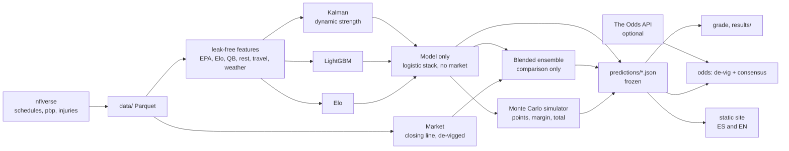

# ensemblitz

NFL game predictions from several models and a score simulator, with picks frozen before kickoff so they can be graded for real. The site is bilingual (Spanish at the root, English under `/en/`).

**Status: v0.1.** A complete, honest pipeline: data, features, models, backtest, predictions, grading and a static site. The ambitious parts (play-by-play simulator, live injuries, hourly weather, Rust) are on the roadmap, not in the code.

## What it does

- Downloads [nflverse](https://github.com/nflverse) data (schedules with odds, play-by-play, injuries) with `nflreadpy` and caches it as Parquet.
- Computes ratings **without information leakage** (only what was known before each game): EPA per play (pass and rush) and success rate adjusted for opponent, with exponential decay and regression to the mean between seasons, margin-of-victory Elo, QB ratings, rest, travel, division, roof and weather.
- Three models and the market:
  1. **Kalman** (state space): each team's offensive and defensive strength evolves week by week, with uncertainty. Hyper-parameters by maximum likelihood on past seasons only.
  2. **LightGBM**, small and heavily regularised (margin), with and without the Las Vegas line as an input (the market variant learns the residual over the spread).
  3. **Elo** with margin of victory.
  4. **Market**: probability without the bookmaker margin from the closing moneyline and spread.
- **Headline number: the model on its own.** A logistic stack of Elo, Kalman and LightGBM (no market input), with a Platt-style bias and a margin and total blend, refitted every week using earlier out-of-sample predictions only. This is what the site shows as the pick.
- **Blended ensemble** (models plus market): still computed and stored for comparison and for the record of earlier picks, but no longer the headline. In the 2018 to 2025 audit it ties with the market and the model alone trails it (see `reports/BASELINE.md`).
- **Monte Carlo simulator** at possession level (NumPy, vectorised): expected points per team with an 80% range, margin and total distributions, and an example score. The interface is meant to be ported to Rust (see `src/ensemblitz/sim/README.md`).
- **Sportsbook odds** (`odds` module, optional): The Odds API, de-vigging (multiplicative and Shin), consensus and comparison with the model. The site shows only the consensus ("Market"), never individual bookmaker prices.



## Usage

```bash
make install                    # uv sync --frozen: Python 3.12 (.python-version) + uv.lock
source .venv/bin/activate       # or prefix each command with `uv run --frozen`
ensemblitz update               # download nflverse 2015 to today
ensemblitz backtest             # walk-forward backtest 2018-2025 -> reports/backtest.md/.json
ensemblitz predict              # next unplayed week -> predictions/<year>/weekXX.json
ensemblitz predict --week 11    # one specific week
ensemblitz grade                # grade picks saved before kickoff -> results/
ensemblitz odds                 # compare with sportsbooks (needs ODDS_API_KEY)
ensemblitz site                 # build the static site into site/_build
make test lint
```

`ensemblitz backtest` takes a few minutes the first time because it fits the Kalman hyper-parameters year by year; afterwards it uses `models/kf_params.json` (`--refit` recomputes).

### Prediction records

Each game in `predictions/<year>/weekXX.json` carries:

- `pick` and `headline`: the picked team and which number made it (`model_only` since web v2; older records have no `headline` and were the blended ensemble).
- `model_only`: win probability, margin, total, expected points per team, a simulation block with 80% range quantiles for each team, margin and total, and an `example_score`.
- `home_win_prob`: every component (`elo`, `kf`, `lgbm`, `lgbm_mkt`, `market`, `ensemble`, `ensemble_model_only`), kept for comparison.
- `absences`: notable Out or Doubtful players with their approximate value in points of margin. Context only; never applied to a number.

Picks of games already kicked off are frozen: re-running `predict` does not rewrite them. `ensemblitz grade` records, per game, which number was the headline (`headline`, `headline_correct`) next to the correctness of every component, so history stays honest across the change of headline.

### Odds (optional)

Export `ODDS_API_KEY` (free plan of [The Odds API](https://the-odds-api.com), 500 requests a month). One call per run, saved in `data/odds/`, and the remaining-quota header is respected; without a key the command is skipped with a notice. The report lands in `reports/odds/<year>_weekXX.md/.json`.

## Baseline and CI gate (Phase 0)

`ensemblitz baseline` audits the model without market, the market close and the blended ensemble over 2018 to 2025 with strict walk-forward (log loss, Brier, accuracy, decile calibration, ATS, 95% bootstrap, extremising and collinearity). Result in [`reports/BASELINE.md`](reports/BASELINE.md). `python scripts/check_baseline.py` fails if the ensemble or the model without market get worse than that baseline (in CI, against `main`); `--full` recomputes everything from nflverse and runs every week in `baseline-full.yml`. Agent rules are in [`AGENTS.md`](AGENTS.md).

## Backtest results (walk-forward 2018 to 2025, 2141 regular-season games)

Each week everything is rebuilt from earlier games only. Detail (by season, calibration, total MAE) in [`reports/backtest.md`](reports/backtest.md).

| Model | Accuracy | Brier | Log loss | Margin MAE | ATS |
|---|---|---|---|---|---|
| Market (close) | 66.4% | 0.211 | 0.610 | 9.83 | n/a |
| Elo (MOV) | 63.2% | 0.223 | 0.638 | 10.23 | 49.6% |
| Kalman (dynamic strength) | 64.4% | 0.224 | 0.638 | 10.21 | 49.7% |
| LightGBM (no market) | 65.0% | 0.222 | 0.634 | 10.24 | 48.4% |
| LightGBM (residual vs market) | 66.5% | 0.213 | 0.614 | 9.98 | 49.2% |
| Simulator (Kalman params) | 64.3% | 0.224 | 0.638 | 10.21 | 50.5% |
| Blended ensemble | 66.2% | 0.212 | 0.611 | 9.83 | 49.3% |

The model alone (the headline since web v2), over the same games in the Phase 0 audit: 64.8% accuracy, Brier 0.222, log loss 0.634 (see `reports/BASELINE.md`).

**Honest reading:**

- The closing market is the rival to beat and it is very good: about 66% accuracy and log loss 0.610. Models without the market sit at 63 to 65% (log loss 0.634 to 0.638), what public models on nflverse data can be expected to reach.
- The blended ensemble ties with the market, it does not beat it (66.2% and 0.611): the stack gives the market almost all the weight because our models add no information it lacks. That is why the market is shown as a reference and the headline is the model alone, which is worse in the record and says so.
- Against the spread nobody clears the 52.4% needed to cover a -110 fee. With disagreement thresholds (3, 5, 8 points) and flat staking no edge appears either (see `reports/backtest.md`).
- Probabilities are well calibrated bucket by bucket (table in the report).
- The simulator, fed with the Kalman expected points, reproduces the Kalman's performance (64%), so the score distribution is coherent; its value is the ranges and the example score, not accuracy.

### Example score

The single most frequent exact score of a simulation is almost always 24-17 (the lattice of 7s and 3s). So the example score is the **most frequent score near the mean of the simulations in which the pick wins by about the predicted margin (within 3.5)**; its exact probability stays around 1% and is stored as is (`example_score.prob`). The site shows it only on the game page, labelled as an example.

## News and absences (optional)

If `news/<year>/weekXX.json` exists, the site shows a "Latest news" block with a link to the source, and `ensemblitz predict` adjusts the **blended ensemble** (not the headline number) for the absences. It never affects the backtest (there is no historical news archive to validate against). Each game stores the adjustment in `news_adjustment`.

```json
[
  {
    "team": "DET",                       // nflverse abbreviation (required)
    "player": "Aidan Hutchinson",        // required
    "position": "DE",                    // QB, RB, WR, TE, T/G/C/OL, DE/EDGE/OLB, DT, LB, CB, S...
    "status": "out",                     // out | doubtful | questionable | returning | other (required)
    "summary_es": "Se pierde el partido por una lesión de tobillo.",
    "summary_en": "Misses the game with an ankle injury.",   // optional, falls back to the Spanish text
    "source_handle": "@AdamSchefter",
    "source_url": "https://x.com/...",
    "posted_at": "2026-11-17T19:00:00Z", // UTC
    "starter": true                      // optional; false = not valued
  }
]
```

**How a player is valued** (`src/ensemblitz/players.py`, nflverse data of the season and the previous one at half weight): points of margin per game over a replacement, multiplied by 0.7 (volume moves to teammates and EPA is noisy).

- **QB, RB, WR, TE:** volume per game x (EPA efficiency shrunk towards the position mean minus replacement efficiency). Replacement = pooled efficiency of low-volume players at the position.
- **Offensive line:** no individual data; snaps x 0.9 points per starter.
- **Defence:** no public individual EPA; position prior (EDGE 1.3, CB 0.9, DT 0.8, LB 0.6, S 0.6) x snap share x production index (sacks, hits, TFL, INT, passes defended per game against the position's starters, shrunk towards 1 and clipped to 0.6 to 1.8). The priors are judgement, not fitted.
- A player missing from the table (rookie, name mismatch) gets half of the position prior.

**Status and freshness:** out = 1, doubtful = 0.75, questionable = 0.25, returning/other = 0. The market line already prices in public news, so an item posted up to 12 h before the pick counts fully, up to 48 h half, older a quarter. A team never loses more than 7 points in total.

The per-game "notable absences" on the site come from a different, walk-forward module (`src/ensemblitz/impact.py`, Phase 1): players listed Out or Doubtful whose value is at least 1.0 point. They are shown as context and are not applied to any number: Phase 1 found no significant gain from injuries (`reports/PHASE1.md`).

## Site

`ensemblitz site` renders `predictions/`, `results/` and `reports/` into `site/_build`: Spanish at the root, English under `/en/`. All user-facing strings live in `src/ensemblitz/site/strings.py`; team names are the official English ones in both languages. The language switch is a plain link between twin pages; the choice is remembered in `localStorage` like the theme. Visual rules are in [`DESIGN.md`](DESIGN.md).

## Limitations

- Realistic target: **65 to 70% straight-up accuracy**. No public model is near 90%, and whoever promises it is usually looking at the future (data leakage).
- v0.1 has **no demonstrated edge over the closing line**; beating it takes information the market lacks (late injuries, hourly weather, rotations) and validating it out of sample.
- The starting QB comes from the nflverse schedule (for future games it is the expected starter); absences are used with a one-week lag, because the current week's report is not there on Tuesday.
- Data since 2015: few seasons for LightGBM; a couple of odd years (2021, 2023) weigh more in the backtest than they look.
- The simulator works at possession level: no safeties, defensive touchdowns, clock, in-game injuries or weather. A skeleton with a stable interface, not the final simulator.
- `depth_charts` and rosters are not used yet.

## Roadmap

1. Play-by-play simulator with injuries **during** the game.
2. Player health and relapse model (IR).
3. Hourly and per-quarter weather (Open-Meteo; a stadium table with coordinates exists in `data/stadiums.py`).
4. Port the engine to Rust with PyO3 (the `sim/` interface is designed for it).
5. JAX/GPU to simulate millions of games in parallel.
6. Full hierarchical Bayesian model (NumPyro/PyMC) in place of the Kalman filter.

## Layout

```
src/ensemblitz/
  data/       download, pbp aggregation, stadiums
  features/   leak-free ratings (EPA, Elo, QB) and the feature table
  models/     kalman, gbm, market, ensemble
  sim/        possession-level simulator (interface portable to Rust)
  odds/       The Odds API, de-vig, discrepancy report, closing-line validation
  site/       static site: build.py, i18n.py, strings.py, templates/, static/
  backtest.py predict.py grade.py cli.py
models/kf_params.json   Kalman hyper-parameters per season (earlier data only)
predictions/ results/ reports/
```

MIT license.
