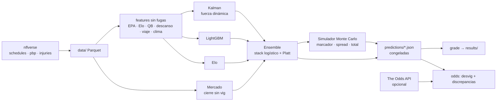

# ensemblitz

Predicción de partidos de la NFL combinando varios modelos y un simulador de marcadores, con picks congelados antes del kickoff para poder calificarlos de verdad.

**Estado: v0.1 (cimientos).** Pipeline completo y honesto de datos → features → modelos → backtest → predicciones → calificación. Lo ambicioso (simulador jugada a jugada, lesiones en vivo, clima por hora, Rust, web) está en la hoja de ruta, no en el código.

## Qué hace

- Descarga datos de [nflverse](https://github.com/nflverse) (calendarios con cuotas, play-by-play, lesiones) con `nflreadpy` y los cachea en Parquet.
- Calcula ratings **sin fugas de información** (solo usa lo que se sabía antes de cada partido): EPA por jugada (pase y carrera) y success rate ajustados por rival, con decaimiento exponencial y regresión a la media entre temporadas, Elo con margen de victoria, ratings de QB, descanso, viaje, división, techo/clima.
- Cuatro modelos + mercado:
  1. **Kalman** (espacio de estados): fuerza ofensiva y defensiva de cada equipo que evoluciona semana a semana, con incertidumbre. Es la versión rápida y exacta de un modelo bayesiano dinámico; hiperparámetros por máxima verosimilitud solo con temporadas pasadas.
  2. **LightGBM** pequeño y muy regularizado (margen), con y sin la línea de Las Vegas como entrada (la variante con mercado aprende el residuo sobre el spread).
  3. **Elo** con margen de victoria.
  4. **Mercado**: probabilidad sin comisión a partir de moneyline/spread de cierre.
- **Ensemble**: apilado logístico (log loss) con calibración tipo Platt y mezcla de márgenes anclada al spread, reajustado cada semana solo con predicciones fuera de muestra anteriores.
- **Simulador Monte Carlo** a nivel de posesión (NumPy, vectorizado): probabilidad de victoria, marcador más probable y distribución de spread/total. Interfaz pensada para portarla a Rust (ver `src/ensemblitz/sim/README.md`).
- **Cuotas de casas de apuestas** (módulo `odds`, opcional): The Odds API, desvig (multiplicativo y Shin), consenso y comparación con nuestro modelo.



## Cómo se usa

```bash
make install                    # uv + dependencias (Python 3.11+)
ensemblitz update               # descarga nflverse 2015-hoy
ensemblitz backtest             # backtest walk-forward 2018-2025 → reports/backtest.md/.json
ensemblitz predict              # próxima semana sin jugar → predictions/<año>/weekXX.json
ensemblitz predict --week 11    # una semana concreta
ensemblitz grade                # califica picks con generated_at anterior al kickoff → results/
ensemblitz odds                 # compara con casas de apuestas (necesita ODDS_API_KEY)
make test lint
```

`ensemblitz backtest` tarda unos minutos la primera vez porque ajusta los hiperparámetros del Kalman año a año; luego usa `models/kf_params.json` (`--refit` para recalcular).

### Cuotas (opcional)

Exporta `ODDS_API_KEY` (plan gratuito de [The Odds API](https://the-odds-api.com), 500 peticiones/mes). Se hace **una** llamada por ejecución, se guarda en `data/odds/` y se respeta la cabecera de cuota restante; sin clave, el comando se salta con un aviso y no falla. El informe sale en `reports/odds/<año>_weekXX.md/.json`: probabilidad nuestra vs cada casa y el consenso, edge, valor esperado al mejor precio y, en desacuerdos grandes (≥ 5 pp), posibles causas sacadas de nuestros datos (cambio de QB, descanso, viento/frío, bajas).

## Resultados del backtest (walk-forward 2018-2025, 2141 partidos de temporada regular)

Cada semana todo se reconstruye solo con partidos anteriores. Detalle (por temporada, calibración, MAE del total) en [`reports/backtest.md`](reports/backtest.md).

| Modelo | Acierto | Brier | Log loss | MAE margen | ATS |
|---|---|---|---|---|---|
| Mercado (cierre) | 66.4% | 0.211 | 0.610 | 9.83 | — |
| Elo (MOV) | 63.2% | 0.223 | 0.638 | 10.23 | 49.6% |
| Kalman (fuerza dinámica) | 64.4% | 0.224 | 0.638 | 10.21 | 49.7% |
| LightGBM (sin mercado) | 65.0% | 0.222 | 0.634 | 10.24 | 48.4% |
| LightGBM (residuo vs mercado) | 66.5% | 0.213 | 0.614 | 9.98 | 49.2% |
| Simulador (params Kalman) | 64.3% | 0.224 | 0.638 | 10.21 | 50.5% |
| Ensemble | 66.2% | 0.212 | 0.611 | 9.83 | 49.3% |

Ensemble frente a mercado por temporada:

| Temporada | Acierto mercado | Acierto ensemble | Log loss mercado | Log loss ensemble |
|---|---|---|---|---|
| 2018 | 66.3% | 65.5% | 0.615 | 0.618 |
| 2019 | 63.7% | 63.7% | 0.619 | 0.623 |
| 2020 | 67.8% | 66.7% | 0.589 | 0.588 |
| 2021 | 62.4% | 62.4% | 0.622 | 0.624 |
| 2022 | 65.8% | 66.5% | 0.609 | 0.610 |
| 2023 | 68.4% | 67.6% | 0.627 | 0.629 |
| 2024 | 71.3% | 72.1% | 0.587 | 0.587 |
| 2025 | 65.7% | 65.3% | 0.609 | 0.611 |

**Lectura honesta:**

- El mercado de cierre es el rival a batir y es muy bueno: ~66 % de acierto y log loss 0,610. Los modelos sin mercado quedan en 63-65 % (log loss 0,634-0,638), el nivel que cabe esperar de modelos públicos con datos de nflverse.
- El ensemble queda **igual que el mercado, no mejor** (66,2 % y 0,611): el apilado le da casi todo el peso al mercado porque nuestros modelos no aportan información que él no tenga.
- Contra el spread (ATS) nadie supera el 52,4 % necesario para cubrir la comisión de −110. Con umbrales de desacuerdo (3, 5, 8 pp) y apuesta plana tampoco aparece ventaja: ver la tabla "¿Le ganamos a la línea de cierre?" en `reports/backtest.md`. Los subconjuntos con ROI positivo son pocos partidos y compatibles con el azar.
- Está bien calibrado: las probabilidades del ensemble coinciden con la frecuencia real por tramos (tabla en el informe).
- El simulador, alimentado con los puntos esperados del Kalman, reproduce el rendimiento del Kalman (64 %), así que la distribución de marcadores es coherente; su valor es dar marcador más probable y rangos, no mejorar el acierto.

## Primeras predicciones congeladas (2026, semana 11)

Generadas con datos hasta la semana 10. Ver `predictions/2026/week11.json` (y `week12.json`, con horizonte de dos semanas).

| Partido | Pick | Prob. local | Margen | Marcador más probable |
|---|---|---|---|---|
| IND @ HOU | HOU | 85% | +12.5 | 24-17 |
| ARI @ KC | KC | 91% | +16.5 | 31-10 |
| BAL @ CAR | CAR | 56% | +2.5 | 24-17 |
| JAX @ NYG | JAX | 29% | -6.0 | 17-24 |
| MIA @ BUF | BUF | 90% | +16.5 | 24-17 |
| NO @ CHI | CHI | 85% | +11.5 | 24-17 |
| TB @ DET | DET | 71% | +6.5 | 24-17 |
| TEN @ DAL | DAL | 78% | +8.5 | 31-24 |
| NYJ @ LAC | LAC | 60% | +3.5 | 24-17 |
| LV @ DEN | DEN | 82% | +10.0 | 24-17 |
| PIT @ PHI | PIT | 31% | -4.5 | 10-17 |
| MIN @ SF | SF | 60% | +3.0 | 17-24 |
| CIN @ WAS | CIN | 25% | -6.5 | 17-24 |

## Limitaciones

- Objetivo realista: **65-70 % de acierto directo**. No hay modelo público que ande cerca del 90 %, y quien lo promete suele estar mirando el futuro (fuga de datos).
- v0.1 **no tiene ventaja demostrada sobre la línea de cierre**; si quieres ganar dinero, hace falta información que el mercado no tenga (lesiones de última hora, clima por hora, rotaciones) y validarla fuera de muestra.
- El QB titular sale del calendario de nflverse (para partidos futuros es el titular previsto); las bajas se usan solo con un retraso de una semana (parte anterior), porque el parte de la semana en curso no está el martes.
- Modelo y datos desde 2015: pocas temporadas para LightGBM; el backtest pesa más de lo que parece un par de años raros (2021, 2023).
- El simulador es a nivel de posesión: no modela safeties, touchdowns defensivos, reloj, lesiones durante el partido ni clima. Es un esqueleto con interfaz estable, no el simulador final.
- No se usa `depth_charts` ni rosters todavía.

## Hoja de ruta

1. Simulador jugada a jugada con lesiones **durante** el partido.
2. Modelo de salud de jugadores y recaídas (IR).
3. Clima por hora y por cuarto (Open-Meteo; ya hay tabla de estadios con coordenadas en `data/stadiums.py`).
4. Port del motor a Rust con PyO3 (la interfaz de `sim/` está pensada para eso).
5. JAX/GPU para simular millones de partidos en paralelo.
6. Web editorial en GitHub Pages (estilo The Athletic / 538, sobria, sin estética de IA).
7. Modelo bayesiano jerárquico completo (NumPyro/PyMC) como sustituto del filtro de Kalman.

## Estructura

```
src/ensemblitz/
  data/       descarga, agregación de pbp, estadios
  features/   ratings sin fugas (EPA, Elo, QB) y tabla de features
  models/     kalman, gbm, market, ensemble
  sim/        simulador por posesión (interfaz portable a Rust)
  odds/       The Odds API, desvig, informe de discrepancias, validación contra el cierre
  backtest.py predict.py grade.py cli.py
models/kf_params.json   hiperparámetros del Kalman por temporada (solo datos anteriores)
predictions/ results/ reports/
```

Licencia MIT.
