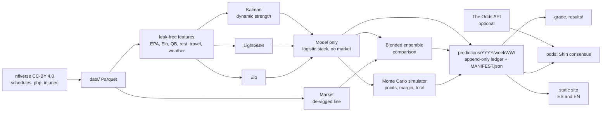

# ensemblitz

NFL game predictions from several models and a score simulator, with picks frozen before kickoff in an append-only SHA-256 ledger so they can be graded for real. The site is bilingual (Spanish at the root, English under `/en/`).

**Status: v0.2.** Walk-forward pipeline, canonical v1 prediction contract (`docs/CONTRACT.md`), append-only ledger (`docs/LEDGER.md`), statistical audit (`docs/audit/pr2-statistical-audit.md`), and bilingual static site deployed to GitHub Pages.

## What it does

- Downloads [nflverse](https://github.com/nflverse) data (schedules with lines, play-by-play, injuries, snaps, player stats) via `nflreadpy` and caches it as Parquet. Data from nflverse is licensed under CC-BY 4.0.
- Computes ratings **without information leakage** (only what was known before each game): EPA per play (pass and rush) and success rate adjusted for opponent, with exponential decay and regression to the mean between seasons, margin-of-victory Elo, QB ratings, rest, travel, division, roof and weather.
- Three models and the market:
  1. **Kalman** (state space): each team's offensive and defensive strength evolves week by week, with uncertainty. Hyper-parameters by maximum likelihood on past seasons only.
  2. **LightGBM**, small and heavily regularised (margin), with and without the pre-game line as an input (the market variant learns the residual over the spread).
  3. **Elo** with margin of victory.
  4. **Market**: probability without the bookmaker margin from the pre-game/closing line (or The Odds API consensus for upcoming games).
- **Headline number: the model on its own.** A logistic stack of Elo, Kalman and LightGBM (no market input), with a Platt-style bias and a margin and total blend, refitted every week using earlier out-of-sample predictions only.
- **Blended ensemble** (models plus market): computed and stored for comparison and for the record of earlier picks. In the 2018 to 2025 audit (`reports/BASELINE.md` and `docs/audit/pr2-statistical-audit.md`), the blend ties with the closing market and the model alone trails it.
- **Monte Carlo simulator** at possession level (NumPy, vectorised): expected points per team with an 80% range (q10 to q90), margin and total distributions, and an illustrative example score.
- **Sportsbook odds** (`odds` module, optional): The Odds API, de-vigging (Shin), and aggregate consensus comparison against the model. Neither the site nor the public reports publish individual bookmaker prices or expected value.



## Usage

```bash
make install                    # uv sync --frozen: Python 3.12 (.python-version) + uv.lock
source .venv/bin/activate       # or prefix each command with `uv run --frozen`
ensemblitz update               # download nflverse 2015 to today
ensemblitz backtest             # walk-forward backtest 2018-2025 -> reports/backtest.md/.json
ensemblitz predict              # next unplayed week -> predictions/<year>/weekWW/<YYYYMMDDTHHMMSSZ>.json
ensemblitz predict --week 11    # one specific week
ensemblitz grade                # grade picks saved before kickoff -> results/
ensemblitz odds                 # compare with sportsbook consensus (needs ODDS_API_KEY)
ensemblitz site                 # build the static site into site/_build
make check                      # lint, format, tests, site guards, outputs, integrity, baseline
```

`ensemblitz backtest` takes a few minutes the first time because it fits the Kalman hyper-parameters year by year; afterwards it uses `models/kf_params.json` (`--refit` recomputes).

### Prediction records and ledger

Each run writes an immutable v1 snapshot under `predictions/<year>/week<WW>/<YYYYMMDDTHHMMSSZ>.json` and extends `predictions/MANIFEST.json` with its SHA-256 digest (see [`docs/CONTRACT.md`](docs/CONTRACT.md) and [`docs/LEDGER.md`](docs/LEDGER.md)). Legacy v0 files (`predictions/2026/week11.json`, `week12.json` and their historical versions) remain untouched on disk and are read through `contract_io.py`.

Each game carries:

- `headline`: the picked team, win probability, margin, total, expected points and simulated distribution (80% ranges, histogram and illustrative example score).
- `ensemble`: the market-blended probability, margin and total kept for comparison.
- `market`: win-probability consensus (`odds_api_consensus` or `nflverse_line`) with explicit `source` and observation timestamp, plus the separate pre-game nflverse spread/total reference line.
- `provenance`: `schema_version`, `model_version`, `code_sha`, `data_cutoff_utc` and input dataset hashes.

## Backtest results (2018 to 2025)

Strict walk-forward over **2,133 decided regular-season games** (2,141 regular-season games played; 8 ties excluded from probabilistic scoring). Every rating, Kalman filter, LightGBM tree and ensemble weight is fitted only on games from earlier weeks. Full metrics and stratified 2-week block bootstrap confidence intervals live in [`reports/BASELINE.md`](reports/BASELINE.md) and [`docs/audit/pr2-statistical-audit.md`](docs/audit/pr2-statistical-audit.md).

| Source | Accuracy | Brier | Log loss |
|---|---:|---:|---:|
| Model only (no market) | 64.8% | 0.2217 | 0.6344 |
| Model blended with the market | 66.2% | 0.2117 | 0.6113 |
| Market (historical closing, margin removed) | 66.4% | 0.2108 | 0.6100 |

- The model alone trails the closing line across 1-, 2- and 4-week block bootstraps (`+0.024` log loss). The market-blended ensemble ties with the closing line without a robust edge.
- Against the spread, no model clears the 52.38% break-even threshold at -110.
- Injuries were audited in Phase 1 (`reports/PHASE1.md`): the paired 95% confidence interval against the no-injury baseline did not clear zero, so injuries are not wired into the probabilities and are shown as context (`impact.notable_absences`).

## Site

`ensemblitz site` renders `predictions/`, `results/` and `reports/` into `site/_build`: Spanish at the root (Europe/Madrid times, decimal commas), English under `/en/` (ET times, decimal points). All user-facing strings live in `src/ensemblitz/site/strings.py`. Visual rules and automated guards are documented in [`DESIGN.md`](DESIGN.md) and enforced by `scripts/check_site.py`.

## Limitations

- Realistic target for public data: **65 to 70% straight-up accuracy**.
- There is **no demonstrated edge over the closing line**; the headline model is also slightly overconfident on heavy favourites (`>= 75%`, documented in PR 2).
- The starting QB in future games is the expected starter from the schedule; injury reports arrive after the Tuesday run.
- The simulator works at possession level (no safeties, defensive touchdowns, clock or in-game injuries).

## Roadmap

1. **PR 5:** Real "why" explanations (Kalman unit contributions, LightGBM attributions, player absence value from nflverse CC-BY 4.0) and key matchups per game (`v1.1` contract).
2. **PR 5b:** Isolated walk-forward calibration experiment for heavy favourites (`>= 75%`), gated by paired log-loss CI.
3. **PR 6:** Per-game kickoff locking (allowing Friday injury-report updates for Sunday/Monday games), external hash anchoring (Sigstore/OpenTimestamps), Open Graph cards, privacy-friendly analytics and Actions data caching.
4. **PR 7:** Walk-forward historical explorer (2018-2025, strictly separated from the live pre-kickoff ledger) and offseason editorial landing page.

## Layout

```text
src/ensemblitz/
  data/         download, pbp aggregation, stadiums
  features/     leak-free ratings (EPA, Elo, QB) and the feature table
  models/       kalman, gbm, market, ensemble
  sim/          possession-level Monte Carlo simulator
  odds/         The Odds API, Shin de-vig, aggregate consensus report
  site/         static site: build.py, i18n.py, strings.py, charts.py, templates/, static/
  contract.py   canonical v1 schema validation and provenance
  contract_io.py unified v0/v1 reader
  ledger.py     append-only snapshot writer and SHA-256 manifest
  backtest.py   baseline.py   phase1.py   predict.py   grade.py   cli.py
docs/           CONTRACT.md, LEDGER.md, audit/
models/         kf_params.json (Kalman hyper-parameters per season, past data only)
predictions/    immutable snapshots and MANIFEST.json
results/        graded live picks
reports/        baseline, backtest, Phase 1 and aggregate odds reports
```

MIT license. NFL data from [nflverse](https://github.com/nflverse) under CC-BY 4.0.
