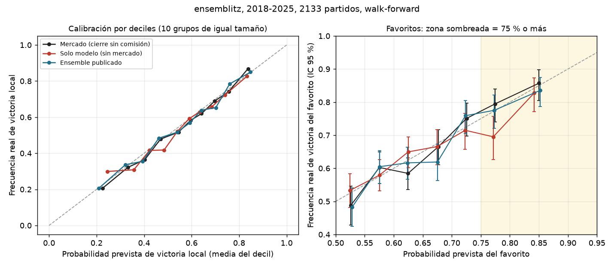

# Línea base 2018 a 2025

> **Informe histórico, no válido para inferencia estadística tras PR2.** Los intervalos de este documento proceden de un bootstrap IID por partido y no preservan la dependencia temporal entre partidos. No uses sus intervalos ni sus afirmaciones de significación. PR2 los sustituye por bootstrap emparejado de temporadas completas; ejecuta `uv run python scripts/audit_pr2.py` para generar el informe actualizado. Los puntos estimados de abajo se conservan como referencia histórica.

Generado el 2026-11-18T21:00:16+00:00. 2133 partidos de temporada regular (2018 a 2025, empates fuera). Datos en `reports/baseline_2018_2025.json`, gráfico en `reports/baseline_calibration.png`. Este documento lo genera `ensemblitz baseline`; no se edita a mano.

## Conclusiones en lenguaje llano

1. **El modelo propio, sin mirar el mercado, está por detrás de las casas.** Su log loss es 0,634 frente a 0,610 del cierre sin comisión: una diferencia de +0,0247 con intervalo del 95 % [+0,0168; +0,0326], que no incluye el cero. Acierta 64,8 % de los partidos frente al 66,4 % del mercado.
2. **El ensemble publicado casi copia al mercado y no lo mejora.** Log loss 0,611 contra 0,610 (+0,0016, IC 95 % [−0,0003; +0,0035]): es peor que el mercado y el intervalo incluye el cero. Los pesos le dan al mercado de media un 75 % del total (87 % contando el LightGBM que corrige al mercado), así que no aporta información propia visible.
3. **Contra el spread, el modelo propio no llega al punto de equilibrio.** Apostando el lado que prefiere contra la línea de cierre: 1024-1057-52 (49,2 %, IC 95 % 47,1 % a 51,4 %). Para ganar dinero con una comisión típica hace falta un 52,38 %. Cuando el modelo discrepa 3 puntos o más del spread: 283-276-8 (50,6 %, IC 95 % 46,5 % a 54,8 %).
4. **La calibración no falla de forma grave.** La pendiente de calibración del ensemble es 0,99 (1 es perfecto) y en los favoritos del 75 % o más apenas está 0,7 puntos por encima de lo real. El modelo sin mercado es el que se pasa de confiado: 0,93 de pendiente. El tramo con mayor desviación del ensemble (con 100 partidos o más) es 65-70%: prevé 67,5 % y ocurre 61,9 % (294 partidos); con tan pocos partidos por tramo hay que leerlo con cautela.
5. **El extremizar existe, pero aquí no hace daño.** Los pesos del ensemble suman más de 1 en el 100 % de los reajustes (media 1,09). Con los pesos limitados a suma 1 el log loss baja 0,0006 y sin sesgo ni extremizar baja 0,0009, pero esa mejora no es estadísticamente distinguible de cero. No hay base para decir que las versiones restringidas calibren mejor fuera de muestra; tampoco para defender el extremizar.

## Resultados globales

| Fuente | Acierto (IC 95 %) | Brier (IC 95 %) | Log loss (IC 95 %) | Pendiente calibración |
|---|---|---|---|---|
| Mercado (cierre sin comisión) | 66,4 % [64,5; 68,4] | 0,211 [0,204; 0,218] | 0,610 [0,594; 0,625] | 1,06 |
| Solo modelo (sin mercado) | 64,8 % [62,8; 66,8] | 0,222 [0,215; 0,228] | 0,634 [0,619; 0,650] | 0,93 |
| Ensemble publicado | 66,2 % [64,2; 68,3] | 0,212 [0,205; 0,219] | 0,611 [0,595; 0,627] | 0,99 |

Diferencia con el mercado (negativo = mejor que el mercado), bootstrap por partidos (10000 remuestreos, semilla 20260):

| Fuente menos mercado | Δ log loss | IC 95 % | Δ Brier | IC 95 % |
|---|---|---|---|---|
| Solo modelo (sin mercado) | +0,0247 | [+0,0168; +0,0326] | +0,0106 | [+0,0071; +0,0141] |
| Ensemble publicado | +0,0016 | [−0,0003; +0,0035] | +0,0006 | [−0,0002; +0,0014] |
| Ensemble, pesos con suma ≤ 1 | +0,0009 | [−0,0004; +0,0023] | +0,0003 | [−0,0003; +0,0009] |
| Ensemble, suma = 1 y sin sesgo (sin extremizar) | +0,0007 | [−0,0004; +0,0018] | +0,0003 | [−0,0002; +0,0008] |

## Por temporada

| Temporada | Partidos | Mercado (acierto / log loss) | Solo modelo | Ensemble | ATS solo modelo |
|---|---|---|---|---|---|
| 2018 | 258 | 66,3 % / 0,615 | 63,6 % / 0,632 | 65,5 % / 0,618 | 52,6 % |
| 2019 | 259 | 63,7 % / 0,619 | 64,9 % / 0,643 | 63,7 % / 0,623 | 49,4 % |
| 2020 | 261 | 67,8 % / 0,589 | 66,7 % / 0,617 | 66,7 % / 0,588 | 53,3 % |
| 2021 | 271 | 62,4 % / 0,622 | 63,1 % / 0,646 | 62,4 % / 0,624 | 50,2 % |
| 2022 | 269 | 65,8 % / 0,609 | 62,8 % / 0,638 | 66,5 % / 0,610 | 46,3 % |
| 2023 | 272 | 68,4 % / 0,627 | 65,1 % / 0,654 | 67,6 % / 0,629 | 45,7 % |
| 2024 | 272 | 71,3 % / 0,587 | 67,6 % / 0,606 | 72,1 % / 0,587 | 49,6 % |
| 2025 | 271 | 65,7 % / 0,609 | 64,6 % / 0,638 | 65,3 % / 0,611 | 46,7 % |

Con unos 270 partidos por temporada, una diferencia de 0,01 en log loss entre fuentes es ruido. Por eso lo que cuenta es el total y su intervalo.

## Calibración por deciles

Diez grupos de igual tamaño según la probabilidad prevista de victoria local. Gráfico: `reports/baseline_calibration.png`.

**Mercado (cierre sin comisión)**

| Decil | Partidos | Prevista | Real | Real menos prevista |
|---|---|---|---|---|
| 1 | 214 | 22,5 % | 20,6 % | −1,9 pp |
| 2 | 214 | 33,2 % | 32,2 % | −1,0 pp |
| 3 | 214 | 40,3 % | 36,4 % | −3,8 pp |
| 4 | 213 | 46,9 % | 47,9 % | +0,9 pp |
| 5 | 213 | 54,5 % | 51,6 % | −2,8 pp |
| 6 | 213 | 59,6 % | 58,2 % | −1,4 pp |
| 7 | 213 | 64,2 % | 62,0 % | −2,2 pp |
| 8 | 213 | 69,8 % | 69,0 % | −0,8 pp |
| 9 | 213 | 75,6 % | 74,2 % | −1,4 pp |
| 10 | 213 | 83,8 % | 86,9 % | +3,1 pp |

**Solo modelo (sin mercado)**

| Decil | Partidos | Prevista | Real | Real menos prevista |
|---|---|---|---|---|
| 1 | 214 | 24,5 % | 29,9 % | +5,4 pp |
| 2 | 214 | 35,7 % | 30,8 % | −4,8 pp |
| 3 | 214 | 42,3 % | 41,6 % | −0,7 pp |
| 4 | 213 | 48,4 % | 41,8 % | −6,6 pp |
| 5 | 213 | 54,0 % | 52,1 % | −1,9 pp |
| 6 | 213 | 59,0 % | 59,2 % | +0,2 pp |
| 7 | 213 | 63,4 % | 62,9 % | −0,5 pp |
| 8 | 213 | 68,5 % | 65,7 % | −2,7 pp |
| 9 | 213 | 74,1 % | 72,3 % | −1,8 pp |
| 10 | 213 | 83,3 % | 82,6 % | −0,7 pp |

**Ensemble publicado**

| Decil | Partidos | Prevista | Real | Real menos prevista |
|---|---|---|---|---|
| 1 | 214 | 20,9 % | 20,6 % | −0,4 pp |
| 2 | 214 | 32,1 % | 33,6 % | +1,5 pp |
| 3 | 214 | 39,4 % | 35,5 % | −3,9 pp |
| 4 | 213 | 46,2 % | 48,4 % | +2,2 pp |
| 5 | 213 | 53,9 % | 51,6 % | −2,3 pp |
| 6 | 213 | 59,2 % | 56,8 % | −2,4 pp |
| 7 | 213 | 64,1 % | 63,8 % | −0,2 pp |
| 8 | 213 | 70,2 % | 65,3 % | −4,9 pp |
| 9 | 213 | 76,0 % | 78,4 % | +2,4 pp |
| 10 | 213 | 84,8 % | 85,0 % | +0,2 pp |

## Favoritos: ¿hay exceso de confianza?

Calibración del lado que cada fuente considera favorito, por tramos de su probabilidad.

**Mercado (cierre sin comisión)**

| Tramo | Partidos | Prevista | Real | IC 95 % del real |
|---|---|---|---|---|
| 50-55% | 275 | 52,6 % | 48,7 % | 42,9 % a 54,6 % |
| 55-60% | 395 | 57,5 % | 60,3 % | 55,4 % a 65,0 % |
| 60-65% | 402 | 62,5 % | 58,5 % | 53,6 % a 63,2 % |
| 65-70% | 302 | 67,7 % | 66,6 % | 61,1 % a 71,6 % |
| 70-75% | 289 | 72,5 % | 75,1 % | 69,8 % a 79,7 % |
| 75-80% | 253 | 77,4 % | 79,4 % | 74,0 % a 84,0 % |
| 80%+ | 217 | 85,0 % | 85,7 % | 80,4 % a 89,7 % |

**Solo modelo (sin mercado)**

| Tramo | Partidos | Prevista | Real | IC 95 % del real |
|---|---|---|---|---|
| 50-55% | 362 | 52,5 % | 53,3 % | 48,2 % a 58,4 % |
| 55-60% | 416 | 57,6 % | 57,9 % | 53,1 % a 62,6 % |
| 60-65% | 391 | 62,5 % | 65,0 % | 60,1 % a 69,5 % |
| 65-70% | 305 | 67,5 % | 66,6 % | 61,1 % a 71,6 % |
| 70-75% | 263 | 72,3 % | 71,5 % | 65,7 % a 76,6 % |
| 75-80% | 187 | 77,1 % | 69,5 % | 62,6 % a 75,7 % |
| 80%+ | 209 | 84,2 % | 82,8 % | 77,1 % a 87,3 % |

**Ensemble publicado**

| Tramo | Partidos | Prevista | Real | IC 95 % del real |
|---|---|---|---|---|
| 50-55% | 282 | 52,8 % | 48,2 % | 42,5 % a 54,0 % |
| 55-60% | 372 | 57,6 % | 60,5 % | 55,4 % a 65,3 % |
| 60-65% | 378 | 62,4 % | 61,6 % | 56,6 % a 66,4 % |
| 65-70% | 294 | 67,5 % | 61,9 % | 56,2 % a 67,3 % |
| 70-75% | 282 | 72,3 % | 75,9 % | 70,6 % a 80,5 % |
| 75-80% | 258 | 77,3 % | 77,5 % | 72,0 % a 82,2 % |
| 80%+ | 267 | 85,2 % | 83,5 % | 78,6 % a 87,5 % |

En los 525 partidos en que el ensemble da al favorito 75 % o más (mismos partidos para todas las fuentes): real 80,6 % (IC 95 % 77,0 % a 83,7 %).

| Fuente | Prevista (media) | Prevista menos real | Log loss |
|---|---|---|---|
| Mercado (cierre sin comisión) | 80,1 % | −0,5 pp | 0,480 |
| Solo modelo (sin mercado) | 76,8 % | −3,7 pp | 0,510 |
| Ensemble publicado | 81,3 % | +0,7 pp | 0,484 |
| Ensemble, pesos con suma ≤ 1 | 79,7 % | −0,9 pp | 0,482 |
| Ensemble, suma = 1 y sin sesgo (sin extremizar) | 79,7 % | −0,9 pp | 0,481 |

Un valor positivo es exceso de confianza. El real queda dentro del intervalo de las previsiones del ensemble: no hay sobreconfianza demostrable en los favoritos claros.

## Pesos del apilado (colinealidad y extremizar)

Las entradas del apilado están muy correlacionadas (en log-odds): mercado con LightGBM sobre el mercado 0,96, mercado con Elo 0,85, Elo con Kalman 0,95. Con fuentes así, sumar señales (pesos con suma mayor que 1) empuja la probabilidad más allá de todas ellas.

Suma de pesos del ensemble por reajuste semanal: mínimo 1,03, media 1,09, máximo 1,24 (100 % de los reajustes por encima de 1). Solo modelo: media 1,07.

Coeficientes del primer reajuste de cada temporada (entrenado solo con temporadas anteriores). Orden: mercado, Elo, Kalman, LightGBM, LightGBM sobre el mercado, y sesgo.

| Temporada | Ensemble: pesos | Suma | Sesgo | Solo modelo: pesos (Elo, Kalman, LightGBM) | Suma |
|---|---|---|---|---|---|
| 2018 | 0,88, 0,27, 0,05, 0,00, 0,00 | 1,19 | −0,00 | 0,72, 0,30, 0,17 | 1,18 |
| 2019 | 0,85, 0,21, 0,06, 0,00, 0,00 | 1,12 | 0,03 | 0,53, 0,42, 0,20 | 1,15 |
| 2020 | 0,83, 0,20, 0,00, 0,00, 0,05 | 1,08 | −0,02 | 0,55, 0,29, 0,25 | 1,08 |
| 2021 | 0,80, 0,16, 0,00, 0,00, 0,15 | 1,12 | −0,06 | 0,55, 0,18, 0,35 | 1,09 |
| 2022 | 0,81, 0,09, 0,00, 0,00, 0,16 | 1,06 | −0,07 | 0,50, 0,11, 0,42 | 1,03 |
| 2023 | 0,83, 0,07, 0,00, 0,00, 0,17 | 1,07 | −0,05 | 0,48, 0,12, 0,43 | 1,03 |
| 2024 | 0,82, 0,02, 0,00, 0,00, 0,20 | 1,04 | −0,03 | 0,42, 0,15, 0,44 | 1,01 |
| 2025 | 0,83, 0,06, 0,00, 0,00, 0,19 | 1,08 | −0,04 | 0,45, 0,11, 0,47 | 1,04 |

Variantes restringidas, mismas pérdida y regularización (fuera de muestra, mismo walk-forward):

| Variante | Log loss | Brier | Pendiente | Δ log loss vs publicado | IC 95 % |
|---|---|---|---|---|---|
| Ensemble publicado | 0,611 | 0,212 | 0,99 | base | n/d |
| Ensemble, pesos con suma ≤ 1 | 0,611 | 0,211 | 1,08 | −0,0006 | [−0,0019; +0,0007] |
| Ensemble, suma = 1 y sin sesgo (sin extremizar) | 0,610 | 0,211 | 1,08 | −0,0009 | [−0,0024; +0,0007] |

**Veredicto.** Las variantes sin extremizar tienen log loss y Brier algo menores y corrigen el signo del exceso en favoritos, pero la mejora cabe dentro del ruido (el intervalo incluye el cero) y su pendiente de calibración se aleja de 1 por el otro lado (el mercado está ligeramente infraconfiado). Conclusión práctica: el extremizar no está estropeando la calibración, tampoco aporta. En la Fase 1 se evaluará la versión con suma de pesos igual a 1 como candidata, sin cambiar la producción ahora.

## ATS del modelo propio contra el cierre

| Muestra | G-P-E | % ganadas | IC 95 % | p-valor frente a 52,38 % |
|---|---|---|---|---|
| Todos los partidos | 1024-1057-52 | 49,2 % | 47,1 % a 51,4 % | 0,004 |
| Discrepa 3 puntos o más | 283-276-8 | 50,6 % | 46,5 % a 54,8 % | 0,421 |

ATS = apostar el lado que el modelo sin mercado prefiere contra el spread de cierre. El 52,38 % es el punto de equilibrio con cuota 1,91 (-110).

## Partes de lesiones de nflverse (para la Fase 1)

Pregunta: ¿el parte guarda el estatus que se conocía antes del partido o lo sobrescribe con los inactivos finales? Se ha comprobado con `scripts/audit_injuries.py` (temporada regular 2015 a 2025, cruzado con los snaps reales de cada jugador).

**Hallazgos**

1. **No se sobrescribe con los inactivos.** Hay una fila por jugador y semana, y conserva la etiqueta oficial `Questionable`, `Doubtful` y `Out`: 15463 filas `Questionable` y 66,7 % de ellas jugaron. Si se hubiera pisado con los inactivos del domingo, ese grupo estaría en 0 % o 100 %.
2. **Es el último parte oficial de la semana, no una foto de las 24 horas previas.** `date_modified` cae en viernes en el 80,0 % de las filas, en miércoles el 8,4 %, en sábado el 7,0 % y en jueves el 4,1 %. Las filas de miércoles son jugadores cuyo estatus no se volvió a tocar. Para 2025 la columna `date_modified` viene vacía, así que ahí no se puede reconstruir la hora.
3. **Las columnas útiles existen, pero el repositorio las tira.** nflverse trae `report_status` (etiqueta final), `practice_status` (entrenamiento del último día registrado), `report_primary_injury` y `date_modified`. `ensemblitz update` solo guardaba `report_status`; este PR hace que conserve también `practice_status` y `date_modified` (los datos tienen que volver a descargarse con `ensemblitz update`).
4. **Solo hay una versión por jugador y semana.** Si un jugador pasó de `Questionable` a `Out` el sábado, el miércoles anterior ya no se ve. Para una prueba con el parte del viernes hay que aceptar que `report_status` es el último antes del partido (jueves a sábado) y documentarlo; una foto exacta de 24 horas antes no existe en esta fuente.

**Probabilidad real de jugar según la etiqueta** (jugó = aparece con algún snap)

| Etiqueta del parte | Filas | Jugó |
|---|---|---|
| Out | 11041 | 0,1 % |
| Doubtful | 1870 | 0,9 % |
| Questionable | 15463 | 66,7 % |
| Probable | 2553 | 95,4 % |
| (sin etiqueta) | 27516 | 92,9 % |

`Questionable` según el entrenamiento registrado:

| Entrenamiento | Filas | Jugó |
|---|---|---|
| Completo | 3083 | 79,7 % |
| Limitado | 9742 | 68,5 % |
| No entrenó | 2469 | 43,5 % |

Por posición hay diferencias grandes: un QB `Questionable` juega el 45,7 % de las veces (339 casos) y un CB el 59,5 %, frente al 71,2 % de un LB.

**Qué significa para la Fase 1.** La baja no se puede tratar como 0 o 1. Se usará la probabilidad de jugar medida arriba (por etiqueta, posición y entrenamiento) multiplicada por el impacto del jugador en puntos de spread. El experimento es reproducible porque el estatus del parte es lo que se sabía antes del partido, pero cualquier cifra de rendimiento del jugador debe calcularse solo con semanas anteriores. Detalle completo en `reports/injury_audit.json`.

## Protocolo y límites

- Walk-forward estricto: cada pila se reajusta antes de cada (temporada, semana) solo con partidos de semanas anteriores (con una aserción de no fuga). Los componentes Elo, Kalman y LightGBM ya salen del pipeline walk-forward. Empates fuera de las métricas probabilísticas.
- El audit recalcula los apilados desde las predicciones fuera de muestra de los componentes (`reports/baseline_components.parquet`). Que esos componentes sean honestos lo cubren los tests de fugas del pipeline; `python scripts/check_baseline.py --full` los regenera desde los datos de nflverse.
- Los modelos usan el spread y la moneyline de cierre de nflverse; el mercado de cierre es el rival más duro posible y no se puede apostar a esa cuota en España.
- El intervalo de confianza no corrige que se miren varias fuentes y variantes a la vez.
- Esta línea base queda fija. La barrera de CI (`scripts/check_baseline.py`) falla si el log loss de cualquiera de las dos fuentes sube más de 0,0015 o el Brier más de 0,0007.
